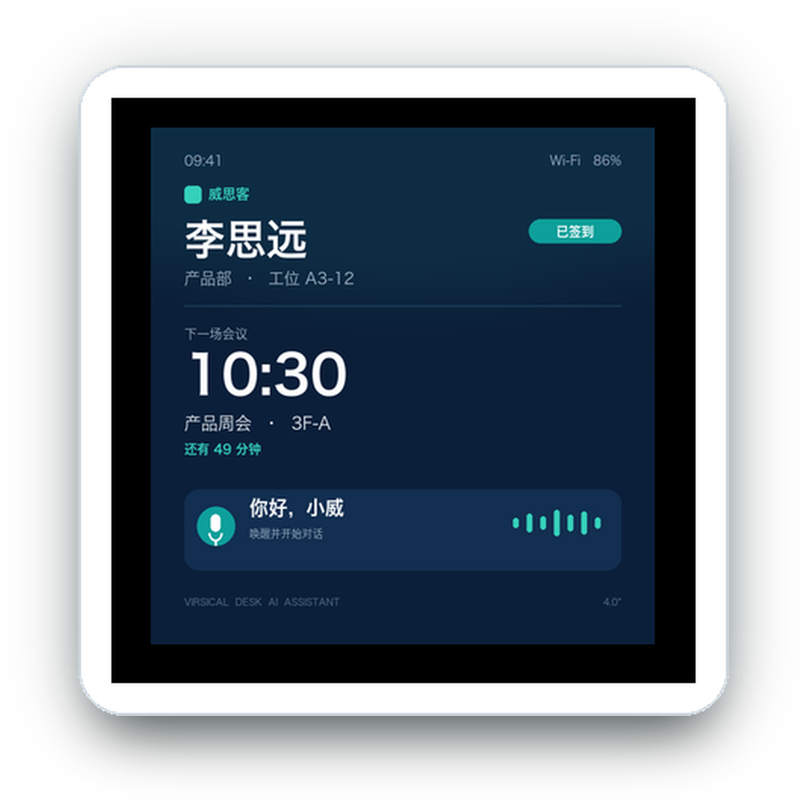
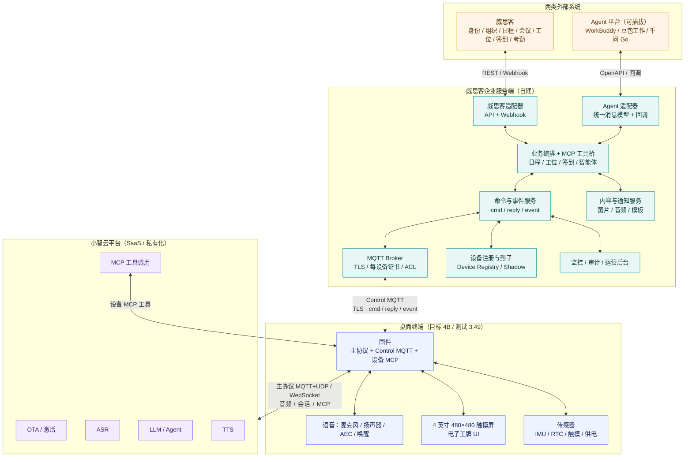
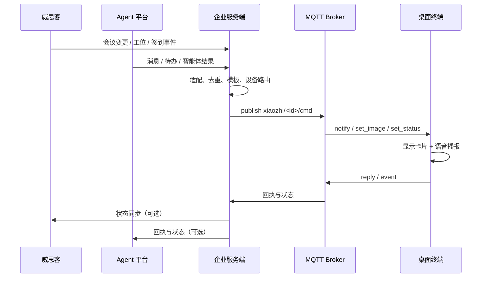
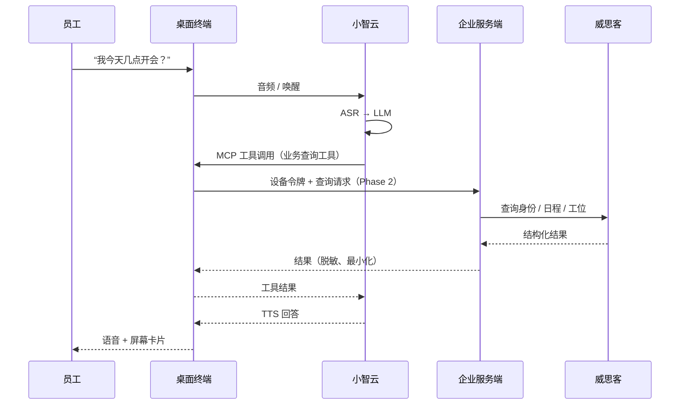
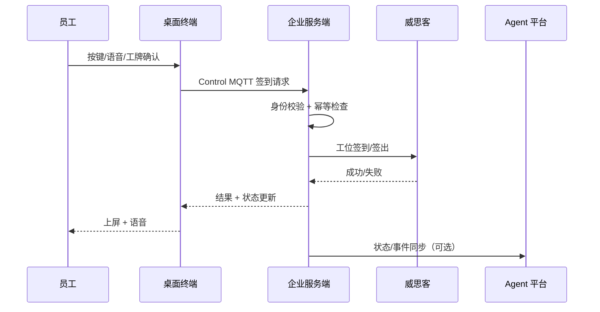

# 威思客桌面 AI 助理 × 桌面电子工牌

> 方案评估与系统架构（基于小智 XiaoZhi ESP32-S3 硬件）
>
> 版本：v0.2 · 2026-10-25 · 内部讨论稿

---

## 1. 一句话方案

把小智语音助手升级为**威思客桌面 AI 助理兼桌面电子工牌**：

- **桌面电子工牌**：员工身份、会议日程、工位与在场状态、签到/签出；
- **桌面 AI 助理**：免提语音、会议提醒、日程/工位问答、Agent 智能体延伸；
- **两类企业连接**：自建服务端只连接**威思客**与**Agent 平台**，不引入第三套身份/日程系统。

核心判断：**技术底座已经具备，产品成败取决于威思客接口、Agent 平台能力、安全合规和运维体系，而不是再做一块新硬件。**

---

## 2. 产品定义

### 2.1 目标用户与场景

| 用户 | 场景 | 价值 |
|---|---|---|
| 员工 | 到工位签到、查看今日会议、临时问日程 | 少打开电脑/手机，桌面直接获得服务 |
| 行政/IT | 工位使用率、会议准时率、设备在线率 | 可量化空间与协作效率 |
| 管理者 | 团队在场状态、会议提醒、Agent 消息触达 | 管理动作延伸到桌面 |
| 访客/前台 | 访客引导、工位/会议室指引 | 电子工牌作为服务触点 |

### 2.2 三类能力

1. **电子工牌**
   - 员工姓名/头像/公司/工位；
   - 今日会议、下一场会议倒计时；
   - 在场/离开/会议中状态；
   - 到岗签到、离岗签出、会议签到。
2. **桌面 AI 助理**
   - 唤醒词 **“你好，小威”** 免提对话；
   - “我今天几点开会”“帮我签到”“会议室在哪”；
   - 会议开始前语音/屏幕提醒；
   - Agent 平台的消息、待办、智能体结果桌面播报。
3. **两类企业连接**
   - **威思客**：身份、组织、日程、会议、工位、签到、考勤——唯一数据源；
   - **Agent 平台**：WorkBuddy / 豆包工作 / 千问 Go 等，通过可插拔适配器接入；试点先选一个。

### 2.3 不做什么（一期边界）

- 不做摄像头人脸识别/考勤打卡；
- 不做完整 OA/IM 替代；
- 不在设备端保存完整会议/员工数据；
- 不直接让大模型无审批地执行高风险业务动作；
- 不新增 SSO/HR/日历独立集成——身份、组织、日程都以威思客为准。


### 2.4 硬件基线：测试用 3.49，目标用 4B

| 项 | 当前测试：ESP32-S3-Touch-LCD-3.49 V2 | 目标：ESP32-S3-Touch-LCD-4B |
|---|---|---|
| 屏幕 | 3.49" IPS，172×640，QSPI，AXS15231B | **4" 方形 IPS，480×480，RGB，ST7701** |
| 触摸 | AXS15231B 集成触摸 | GT911 电容触摸 |
| SoC / 存储 | ESP32-S3R8，16MB Flash，8MB PSRAM | ESP32-S3R8，16MB Flash，8MB PSRAM |
| 音频 | ES8311 DAC + ES7210 ADC，双麦，扬声器接口 | ES8311 + ES7210，贴片麦克风，8Ω 2W 扬声器 |
| 供电 | USB-C 5V | **USB-C 5V 固定外接（一期不做电池）**；板上 AXP2101 + 锂电接口保留但不用 |
| IMU / RTC | QMI8658 / PCF85063 | QMI8658 / PCF85063 |
| 形态 | 3.49" 条形屏，适合手持/长条面板 | **4" 方形屏，目标产品外观按 4B** |



> 上图为效果示意：正面外壳取自官方 4B 尺寸图，屏内为威思客工牌 UI；不是最终固件截图。

**对方案的影响：**

- 4B 的 480×480 方形屏更适合“桌面电子工牌 + 会议卡片”，但现有 3.49 的 640×172 条形 UI **不能直接复用**，需要重新设计卡片布局、字体层级和手势。
- 当前 fork 的 `waveshare/esp32-s3-touch-lcd-4b` 板级目录已存在（基于通用 `LcdDisplay`），但 fork 的 `CustomLcdDisplay` 手势/公司 logo、IMU/RTC 监控等定制仍主要绑在 3.49 板；需要做 4B 功能对齐。
- 控制通道、设备 MCP、音频链路、配网等与板级无关，可在 3.49 上继续验证；**建议尽快把 4B 作为主开发目标**，避免 UI 和硬件适配在试点前返工。
- 4B 为 65K 色（16 位），3.49 为 16.7M 色；UI 设计需按 16 位色和 480×480 做验收，不要按 3.49 的显示效果签样。
- **一期全部固定外接供电**：不做电池、电量 UI 与充放电策略；AXP2101 只作板上电源路径，RTC 用纽扣电池走时。随之新增固件要求：断电重启自恢复、看门狗、上电快速重连。IMU 的「拿起/移动」类功能在固定桌面场景价值下降，在场判定改由交互/日程驱动。

> **P4 版本已评估、一期不采用**：ESP32-P4-WIFI6-Touch-LCD-4B（含 `ESP32-P4-86-Panel-ETH-2RO` 变体）在算力、720×720 屏、有线网口和 RS485/继电器上更强，但缺少 IMU、86 Panel 变体无摄像头、86 底盒 + DC 6–30V 偏墙面工程形态，且本 fork 没有该变体的板级支持；一期固定供电后，电池已不是差异项。对比与评分见 [4B 选型对比](virsical-board-selection-4b-vs-p4.md)。

---

## 3. 系统架构

### 3.1 总体架构



> **架构约束**：企业服务端只连接三类对象——小智硬件（Control MQTT）、威思客、Agent 平台。企业服务端**不直连小智云**，也不新增 SSO/HR/日历等第三套系统；身份、组织、日程由威思客统一提供。

### 3.2 分层说明

| 层 | 职责 | 关键点 |
|---|---|---|
| 桌面终端 | 采集语音、显示工牌、执行控制命令、上报本地事件 | 目标 4B（480×480 方形屏）；当前 3.49 用于固件/音频基线验证 |
| 小智云 | ASR/LLM/TTS、设备 MCP 工具调用、OTA/激活 | 语音智能由平台提供；当前先用 SaaS，后续可私有化/与企业服务端合并部署 |
| 企业服务端 | 设备接入、命令/事件、威思客/Agent 适配、AI 编排、内容、运维 | 本方案新增的核心；是企业数据与设备之间的唯一网关 |
| 两类外部系统 | 威思客（身份/组织/日程/工位/签到）；Agent 平台（智能体/消息/工作流） | 只做这两类连接，边界清晰 |

### 3.3 双通道职责

| 通道 | 连接 | 用途 | 关键约束 |
|---|---|---|---|
| 主协议 | 设备 ↔ 小智云 | 语音会话、音频流、云端 ASR/LLM/TTS、MCP 工具调用 | 依赖小智云可用性；音频链路对网络敏感 |
| 第二路 MQTT | 设备 ↔ 企业 Broker | 远程控制、业务推送、设备事件、状态查询 | 常连、低延迟；企业版必须 TLS + 每设备认证 + ACL |

第二路 MQTT 主题约定：

```text
下行：xiaozhi/<device_id>/cmd
上行：xiaozhi/<device_id>/reply
```

常用下行命令（已实现）：

```text
notify          播放通知/提示音
set_image       下发会议卡片/工牌背景/二维码
set_status      状态栏文字
set_theme       主题
set_volume      音量
set_brightness  亮度
listen / abort  远程会话控制
mcp             设备端 MCP 工具调用
query_status    设备状态查询
set_imu         IMU 运动检测开关
```

> 当前事件为 QoS 0、离线不补发；企业版需要服务端设备影子、命令幂等、失败重试和离线补偿。

### 3.4 关键集成点：MCP 的业务边界

小智云当前的 MCP 主要调用**设备端工具**（音量、屏幕、主题等），并不能天然访问威思客/Agent 平台的业务数据。要支持“问今天日程/工位/会议”，推荐：

| 方案 | 做法 | 优点 | 风险/前提 |
|---|---|---|---|
| **A. 设备 MCP 代理（推荐）** | 在设备 MCP Server 增加业务查询工具，工具实现调用企业服务端 HTTP API | 不改变“服务端只连威思客/Agent”的边界；复用现有 MCP | 设备需短期令牌；固件增加 HTTP/TLS；业务数据不落设备 |
| B. 企业远程 MCP Server | 企业服务端暴露标准 MCP，小智云作为客户端调用 | 业务逻辑集中在服务端 | 会增加“服务端 ↔ 小智云”一条连接，与当前架构约束冲突；且需确认平台支持 |
| C. 控制通道推送 + 本地规则 | 服务端把日程/工位卡片推到设备，语音只做设备控制 | 最简单、最稳 | 大模型不能自由问答业务数据 |

**建议**：一期用 C 保证可用；二期用 A 做 PoC。B 仅作为未来平台能力确认后的备选，不作为当前架构前提。

### 3.5 关键链路

#### 链路一：业务消息推送



#### 链路二：语音问日程/工位



#### 链路三：工位签到/签出 + Agent 延伸



### 3.6 部署形态：SaaS → 私有化 → 与企业服务端合并

小智云支持私有化部署，意味着部署形态可以分三步演进，但**不建议一期就做合并**：

| 阶段 | 形态 | 优点 | 代价/边界 |
|---|---|---|---|
| **一期：SaaS 试点** | 小智云公有云 | 上线快、语音能力成熟、运维最轻 | 数据出企业、依赖公网和云服务 SLA |
| **二期：私有化 PoC** | 小智云部署在企业侧/专有云 | 数据可控、低时延、可定制 | GPU/存储/运维/许可成本；需要企业 IT 承接 |
| **三期：平台合并** | 私有化小智云 + 企业服务端统一部署 | 共享身份、设备注册、观测与网关；减少跨网 | 不能把语音平面塞进业务单体；升级节奏、安全域、故障域要隔离 |

**合并的架构原则：**

- **逻辑分离**：语音平面（ASR/LLM/TTS/MCP 编排）与业务平面（威思客/Agent/控制 MQTT）保持独立服务边界；合并是部署和组织的合并，不是代码单体化。
- **接口先抽象**：设备认证、OTA 地址、MCP 工具契约、观测指标、配置中心先标准化，避免被单一部署形态锁死。
- **数据边界**：语音是否留存、留存多久、是否出境，要在私有化/合并前定清楚；业务数据仍按最小化原则。
- **可回退**：私有化或合并后保留 SaaS 回退路径；设备仍保留“主协议语音 + 第二路 MQTT 控制”双通道。
- **节奏建议**：一期 SaaS 试点 → 二期私有化 PoC → 三期合并；不要在验证产品价值前投入私有化重资产。

---

## 4. 方案评估

### 4.1 总评

| 维度 | 评分 | 判断 |
|---|---|---|
| 技术可行性 | 8.0 / 10 | 固件、控制通道、MCP、硬件都已具备；企业服务端与威思客/Agent 接口是主要工作量 |
| 产品差异化 | 8.5 / 10 | “桌面 AI + 电子工牌 + 企业智能体”组合有辨识度 |
| 集成复杂度 | 6.5 / 10 | 只连威思客和 Agent 两类，边界清晰；但威思客是唯一身份/日程源，Agent 平台 API 差异大 |
| 安全与合规 | 5.0 / 10 | 当前控制通道默认明文/默认凭据、OTA 关闭；企业版必须补齐 |
| 可运维性 | 5.5 / 10 | 设备注册、OTA、监控、离线补偿需要从零建设 |
| 交付成本 | 6.5 / 10 | 硬件复用降低 BOM；云端 ASR/LLM/TTS 与研发投入是主要成本 |
| **综合** | **7.1 / 10** | **适合 30–50 台试点，不建议直接大规模铺开** |

### 4.2 优势

1. **不用从零做硬件**：小智硬件已有 ESP32-S3、音频、AEC、触摸屏、Wi-Fi、IMU、RTC；桌面场景固定 5V 供电，不需要电池。
2. **控制通道已经跑通**：第二路 MQTT 已支持通知、图片、状态、音量、亮度、会话控制、设备 MCP 调用和事件上报。
3. **语音智能不用自建**：ASR/LLM/TTS 由小智云提供（SaaS 或私有化），企业侧聚焦业务与集成。
4. **架构边界清晰**：只有威思客 + Agent 两类外部连接，身份/组织/日程不在服务端重复建设。
5. **Agent 可插拔**：WorkBuddy / 豆包工作 / 千问 Go 通过统一适配层接入；试点先选一个，避免多平台同时适配。
6. **可渐进交付**：先推送/工牌/签到，再做语音业务问答和 Agent 智能体，风险可控。

### 4.3 主要风险与应对

| 风险 | 影响 | 应对 |
|---|---|---|
| **MCP 业务边界未验证** | 语音问日程/工位可能无法直接实现 | 先做设备 MCP 代理 PoC；一期用控制通道推送兜底；不依赖服务端直连小智云 |
| **威思客是唯一身份/日程源** | 威思客 API 缺失/unstable 会直接阻塞项目 | 先确认身份、组织、日程、工位、签到 API/Webhook；做契约测试与降级缓存 |
| **Agent 平台差异** | WorkBuddy/豆包/千问的消息、会话、动作模型不同 | 统一 Agent 适配层 + 标准消息模型；试点只选一个平台，二期再扩展 |
| **部署形态选择** | SaaS 数据出企业/依赖公网；私有化增加 GPU、运维和许可成本 | 一期 SaaS 试点；二期私有化 PoC；接口先抽象，保留回退 |
| **安全与身份** | 企业数据、员工隐私、设备被冒充 | TLS 8883 + 每设备证书 + Broker ACL；禁用默认凭据；最小化数据；审计 |
| **OTA 与运维** | 设备出问题无法远程修复 | 恢复签名 OTA；设备影子、远程日志、看门狗、灰度发布 |
| **QoS 0 / 离线** | 会议提醒丢失、签到状态不一致 | 服务端重试 + 设备影子 + 幂等键；关键命令升级 QoS 1 |
| **桌面体验** | 4B 为 4 英寸 480×480，信息密度仍有限 | 只显示“下一场会议 + 状态 + 一个动作”；详细内容语音/手机兜底 |
| **网络覆盖** | 企业 Wi-Fi 漫游/认证导致掉线 | 现场勘测；支持 2.4G/5G；断线重连；本地缓存 |
| **4B 硬件/UI 迁移** | 3.49 的条形 UI 不能直接复用；4B 的手势/IMU/RTC UI 需要适配；固定供电需补断电重启与看门狗 | 4B 板级 bring-up 提前；480×480 工牌 UI 单独设计；3.49 只做固件基线 |

### 4.4 关键待确认问题

1. 威思客是否提供完整的**身份、组织、日程、会议、工位、签到、考勤** API/Webhook？频率限制与鉴权方式？
2. 设备如何绑定员工与工位：由威思客下发绑定关系，还是管理员在服务端配置？
3. 签到方式：工位绑定 + 按键/语音确认，还是屏幕二维码由手机扫？
4. 试点 Agent 平台选哪一个（WorkBuddy / 豆包工作 / 千问 Go）？其消息、会话、动作/回调能力边界？
5. 小智云 MCP 是否支持设备 MCP 工具发起 HTTP 调用（设备侧网络/证书/令牌限制）？
6. 数据合规：语音是否留存？会议/员工数据在设备端保留多久？是否要求小智云私有化/数据不出企业？
7. 私有化/合并的边界：企业 IT 是否能提供 GPU/存储/运维？合并后语音平面与业务平面如何隔离？
8. 试点场地、网络、工位数量、IT 安全评审流程。

---

## 5. 分期落地

| 阶段 | 周期 | 交付 | 退出标准 |
|---|---|---|---|
| Phase 0：PoC | 2 周 | 企业 Broker + 设备注册 + 控制推送 + **4B 板级 bring-up / 480×480 工牌 UI** + 威思客模拟数据；3.49 继续验证音频/控制 | 4B 能稳定收到会议/签到卡片并回执 |
| Phase 1：MVP | 4–6 周 | 4B 工牌 UI/手势/IMU/RTC/电量对齐；威思客适配（身份/组织/日程/会议/工位/签到）；Agent 适配（试点 WorkBuddy）消息推送；运营后台 | 30–50 台 4B 试点稳定运行 2 周 |
| Phase 2：AI 深化 | 4–6 周 | 设备 MCP 业务工具、语音问日程/工位、选定 Agent 双向智能体、OTA/安全基线、**小智云私有化 PoC** | 语音任务成功率 ≥ 85%，无 P1 安全问题；私有化 PoC 跑通 |
| Phase 3：规模化 | 3–6 月 | 多园区、多租户、SLA、灰度发布、成本优化、Agent 平台扩展、**私有化/与企业服务端合并部署** | 通过安全/合规评审，可复制到下一园区 |

### 试点成功指标

- 设备在线率 ≥ 99%（工作日）；
- 会议提醒到达率 ≥ 99%，端到端延迟 < 5 秒；
- 工位签到/签出成功率 ≥ 98%；
- 语音任务成功率 ≥ 85%（试点期）；
- 会议准时率/工位使用率有可对比提升；
- Agent 消息触达率与回执率可观测。

---

## 6. 给老板的决策请求

1. **批准试点**：30–50 台、6–8 周、1–2 个楼层。
2. **指定接口人**：威思客、选定的 Agent 平台、IT 安全/网络各一名。
3. **确认产品边界与外观**：一期做“身份/日程/会议 + 工位 + 工牌 + 消息推送”，外观按 **ESP32-S3-Touch-LCD-4B** 方形屏定义；AI 业务问答与 Agent 智能体作为二期。
4. **确认 Agent 试点平台**：建议先选 WorkBuddy；豆包工作/千问 Go 通过适配层预留，不在 MVP 同时接。
5. **确认部署模式**：一期 SaaS 试点；二期私有化 PoC；三期再评估与企业服务端合并，不在试点期做重资产私有化。
6. **确认预算口径**：硬件复用；预留云端语音调用、服务端资源、集成研发、试点支持。

**一句话结论**：这不是“再做一个语音音箱”，而是把威思客的身份、组织、日程、会议、工位和签到，以及 Agent 平台的智能体能力，装进每个人桌面上的一个 AI 工牌入口。建议先小规模试点，用数据证明价值，再规模化。

---

## 7. 关联材料

- 汇报 PPT：[virsical-desktop-ai-badge-brief.pptx](virsical-desktop-ai-badge-brief.pptx)
- 汇报 PDF：[virsical-desktop-ai-badge-brief.pdf](virsical-desktop-ai-badge-brief.pdf)
- 架构图 PNG：[virsical-desktop-ai-badge-architecture.png](virsical-desktop-ai-badge-architecture.png)
- 硬件选型对比（S3-4B vs P4-4B / 86 Panel）：[说明文档](virsical-board-selection-4b-vs-p4.md) · [PPT](virsical-board-selection-4b-vs-p4.pptx) · [PDF](virsical-board-selection-4b-vs-p4.pdf)
- 控制通道协议：[control-mqtt.md](control-mqtt.md)
- 项目总览：[PROJECT_OVERVIEW.md](../PROJECT_OVERVIEW.md)
