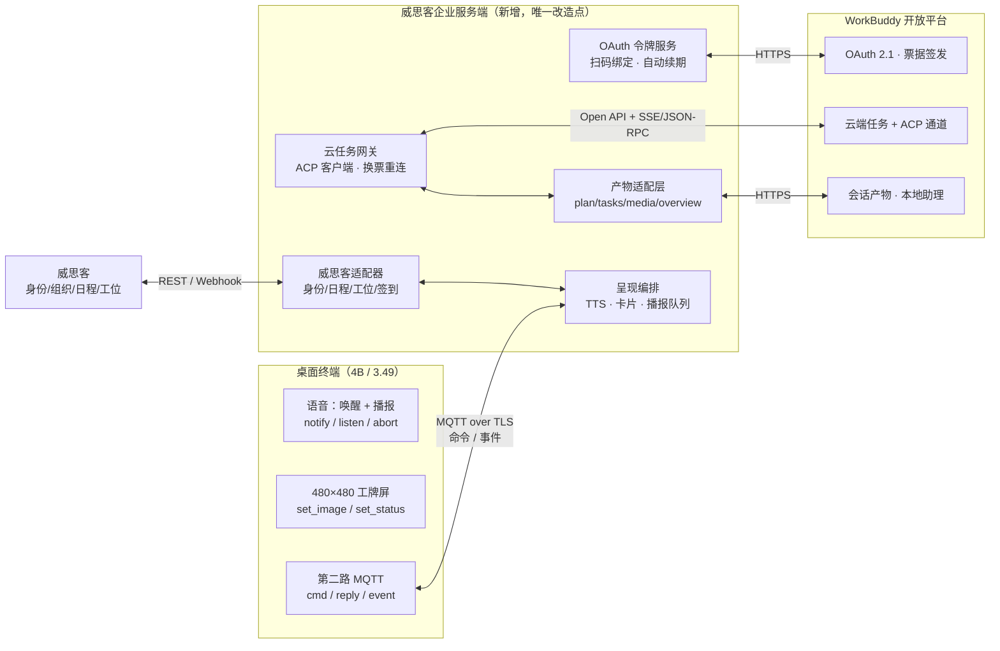
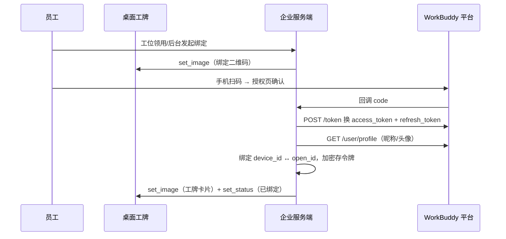
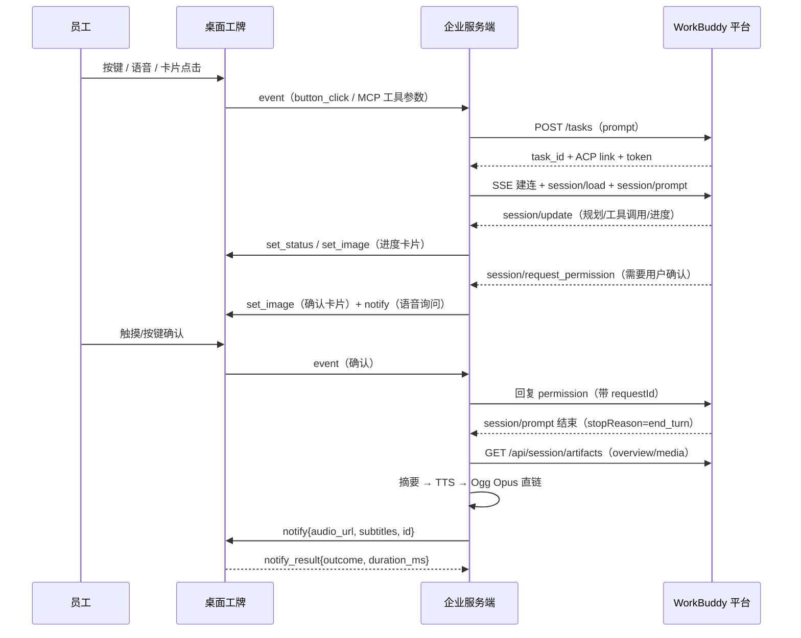
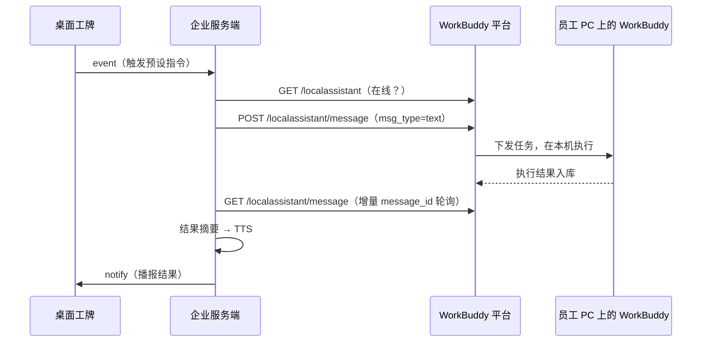

# 威思客桌面 AI 工牌 × WorkBuddy 开放平台 对接评估

> 版本：v0.1 · 2026-10-26 · 评估稿
>
> 评估对象：[威思客桌面 AI 助理 × 桌面电子工牌方案](virsical-desktop-ai-badge-architecture.md)（硬件端 4B/3.49 + 第二路 MQTT 控制通道 + 小智云语音）
>
> 平台依据：WorkBuddy 开放平台官方文档（open.workbuddy.cn）—「第三方应用 / 硬件接入」与「Open API 接口 v2」
>
> 前提：企业服务端尚未开发，本评估按"从零设计服务端"考虑，功能范围不受现有限制约束

---

## 1. 结论摘要

| 维度 | 评分 | 判断 |
|---|---|---|
| 技术可行性 | 8.5 / 10 | 平台是标准 HTTPS + OAuth 2.1 + SSE/JSON-RPC，服务端侧无技术黑盒；难点在 ACP 长连接工程与设备侧呈现适配 |
| 设备端改造量 | **极小** | **除"语音下发任务"一项外，全部功能零固件改动**；设备已有的 `notify / set_image / set_status / listen / query_status` 与事件上报足够承载所有回传呈现 |
| 服务端改造量 | 中 | 服务端是唯一新增改造点，约 **22–34 人日**（含 ACP 客户端、产物适配、TTS 播报、权限确认、运维） |
| 功能增益 | 高 | 从"能推送 + 能播报"升级为"能派活 + 能执行 + 能回传产物 + 能替用户拍板 + 能遥控 PC"，直接补齐架构文档 §3.4 的核心短板 |
| 主要风险 | 中 | 平台资质审核周期、ACP 票据有效期、语音文本最后一公里、480×480 屏的产物适配、双云端数据合规 |
| **综合** | **7.8 / 10** | **建议将 WorkBuddy 定为首选试点 Agent 平台**（回答架构文档 §4.4 待确认问题 4），豆包工作 / 千问 Go 保留在适配层 |

**一句话结论**：WorkBuddy 开放平台提供的是"任务执行 + 产物回传 + 权限确认 + 跨端记忆"，而不是又一个聊天接口——这恰好是原方案里唯一没有的东西。设备不需要改、架构约束不需要破，只需要新增一个服务端，把设备已有的"显示 + 播报 + 按键/触摸"能力接到平台的"云端任务 + 产物"上。

---

## 2. 平台能力盘点：能拿到什么

WorkBuddy 开放平台对「硬件接入」类应用**开放全部 Scope**（按业务需要申请，遵循最小权限原则）。本项目实际需要的只有 5 个：

| 能力域 | Scope | 关键接口 | 对本项目价值 |
|---|---|---|---|
| 认证授权 | —（应用凭据） | `GET /openapi/v2/authorize`、`POST /openapi/v2/token` | 员工个人授权，服务端换取/刷新票据；`access_token` 约 24h，`refresh_token` 约 60 天 |
| 用户资料 | `user.profile.readable` | `GET /openapi/v2/user/profile` | **电子工牌身份卡**：昵称 + 头像直接上屏，不必自建 |
| 联系方式校验 | `user.contact.readable` | `POST /openapi/v2/user/phoneverification` | 工牌与人绑定时的二次核验（只返回 matched，不返回号码） |
| 云端任务 | `user.task.invokable` / `user.task.readable` | `POST /openapi/v2/tasks`、`GET /openapi/v2/tasks/{id}` | **核心**：一句话创建 AI 任务，云端自主规划执行；查状态/查列表 |
| ACP 通道 | （同任务票据） | `GET {link}`（SSE）+ `POST {link}`（JSON-RPC） | **核心**：实时双向通道，流式增量、任务状态、权限请求、产物事件 |
| 会话产物 | （同任务票据） | `GET {sandbox_url}/api/session/artifacts` | 拉取 plan / tasks / media / overview，转成工牌卡片与播报文本 |
| 本地助理 | `user.localassistant.invokable` / `.readable` | `POST/GET /openapi/v2/localassistant/message` | **差异化**：工牌遥控用户 PC 上的 WorkBuddy，读在线状态、发消息、拉回复 |
| 积分权益 | `user.credit.exchange` | `POST /openapi/v2/redemptions` | 随设备赠送积分 / 活动发码（商业闭环，可选） |

**两个平台侧硬约束（设计时必须吸收）**

1. 平台只提供 **OAuth 2.1 授权码模式**（无设备码模式）。ESP32 没有浏览器，**授权必须由手机或 PC 完成**，票据保存在服务端。
2. ACP 票据（`token`/`task_ticket`）用于 ACP 与产物接口，文档明示"通常 3 天，可能更短"，**401 时必须回查 `GET /tasks/{task_id}` 换新票**。服务端必须实现自动换票与 SSE 重连。

---

## 3. 对接架构

### 3.1 三条接入路径对比

| 路径 | 做法 | 评价 |
|---|---|---|
| **① 服务端中继（推荐，唯一现实路径）** | 设备只与企业服务端 MQTT 通信；服务端持有员工票据，代调 WorkBuddy Open API、维护 ACP 长连接、把结果翻译成设备命令 | 设备零改动；令牌/证书/长连接全部落在服务端；完全符合原架构"服务端只连威思客 + Agent 平台"的约束 |
| ② 设备直连平台 | ESP32 上跑 OAuth + HTTPS + SSE 解析 | **不可行**：票据与 TLS 证书管理、SSE 长连接内存、JSON 体积都超出 MCU 承受范围，且令牌泄露风险高 |
| ③ 端侧智能体 SDK | 腾讯硬件白皮书提到端侧 SDK（感知/调度/记忆同步），但**当前开放平台公开文档只有 Open API，未见嵌入式 SDK 与音频链路** | **待确认**：需向平台商务确认 SDK 是否开放、是否含 ASR/TTS。若含语音链路，二期可评估替换小智云做统一语音入口；一期不押注 |

### 3.2 分层架构（服务端中继）

### 3.3 三方的职责边界（重要）

| 方 | 承担 | 不承担 |
|---|---|---|
| **设备** | 唤醒、收音、播报、显示卡片、按键/触摸确认、状态上报 | 不持有任何用户票据、不做业务查询、不解析任务内容 |
| **企业服务端** | 授权与令牌托管、任务网关、产物翻译成"卡片 + 播报"、队列与幂等、审计 | 不做 AI 推理（规划/执行在云端） |
| **WorkBuddy 平台** | 任务规划与执行、工具调用、产物生成、跨端记忆、权限请求 | 不碰威思客的组织/日程/工位数据（除非后续通过 Connector 显式接入） |
| **威思客** | 身份、组织、日程、会议、工位、签到——**仍是唯一数据源** | 不被 WorkBuddy 替代 |

> **边界红线**：WorkBuddy 的 `user.profile` 只用于**个人形象展示**（昵称/头像），组织架构、工位、考勤一律以威思客为准，避免两套身份源。

---

## 4. 对接后能实现的功能清单

图例：**固件改动**列 —— 否 = 完全复用现有固件能力；是 = 需新增固件代码。

### A. 身份与激活

| # | 功能 | 平台能力 | 设备命令 | 固件改动 |
|---|---|---|---|---|
| A1 | **扫码绑定 + 工牌身份卡**：设备屏显二维码 → 手机授权 → 服务端换票 → 拉取昵称头像 → 合成工牌卡片上屏 | OAuth 2.1 + `user/profile` | `set_image`（合成后的卡片图）、`set_status` | 否 |
| A2 | **绑定/解绑生命周期**：离职或换工位时服务端解绑，设备回落访客态 | 服务端令牌管理 | `set_status` | 否 |
| A3 | 手机号二次核验（领用登记、访客工牌） | `user.contact.readable` | `set_status` | 否 |

### B. 派活与执行（核心增益）

| # | 功能 | 平台能力 | 设备命令 | 固件改动 |
|---|---|---|---|---|
| B1 | **一句话派活**：创建云任务，云端自主规划执行（查资料、写文档、生成表格、跑脚本） | `POST /tasks` + ACP | — | 见 §4.1 |
| B2 | **任务进度上屏**：pending / in_progress / completed 实时更新为工牌上的任务条 | ACP `session/update` + tasks 产物 | `set_status` / `set_image`（进度卡片） | 否 |
| B3 | **结果摘要播报**：任务完成 → 服务端把 overview 摘要合成语音 → 设备播报 + 字幕同步 | artifacts `overview` + 服务端 TTS | `notify{audio_url, subtitles, id}` | 否 |
| B4 | **追问与接续**：同一 `task_id` 复用会话继续追问，记忆不丢 | ACP `session/prompt` | — | 见 §4.1 |
| B5 | **一键快捷任务**：BOOT 键 / 屏幕卡片触发预设任务（如"今日进展汇报""待办清单"） | `POST /tasks` | 已有 `button_click` / 双击事件 | 否（PoC 可复用现有事件） |
| B6 | **定时与主动服务**：结合威思客日程，会议前 10 分钟自动生成准备材料并播报 | 平台定时任务能力 + 威思客 | `notify` | 否 |

### C. 替用户"拍板"（差异化亮点）

| # | 功能 | 平台能力 | 设备命令 | 固件改动 |
|---|---|---|---|---|
| C1 | **权限确认上桌面**：云端执行需要授权（工具调用/AskUserQuestion）→ 工牌弹确认卡片 + 语音询问 → 用户触摸或按键确认 → 服务端回复 | ACP `session/request_permission` | `set_image` 卡片 + 触摸/按键事件 | 否（复用双击/按键事件，语义略 hack；正式版建议加专用确认事件） |
| C2 | **超时与降级**：用户 60 秒未响应 → 自动拒绝并播报"已取消" | 服务端策略 | `notify` | 否 |
| C3 | **预授权白名单**：低风险工具自动放行，不打扰 | 服务端策略 | — | 否 |

### D. 产物回传与展示

| # | 功能 | 平台能力 | 设备命令 | 固件改动 |
|---|---|---|---|---|
| D1 | **图片产物上屏**：生成的图表/截图 → 服务端转码压缩 → 设备预览或设为壁纸 | artifacts `media` | `set_image{url, mode}` | 否 |
| D2 | **计划/清单卡片**：plan 与 tasks 渲染成 480×480 卡片图 | artifacts `plan` / `tasks` | `set_image` | 否 |
| D3 | **产物不落设备**：设备只显示转码后的图，原文/原始文件留在服务端 | — | — | 否 |

### E. PC 本地助手联动（独占能力）

| # | 功能 | 平台能力 | 设备命令 | 固件改动 |
|---|---|---|---|---|
| E1 | **工牌遥控 PC**：对着工牌说/按一下 → 服务端向用户 PC 上的 WorkBuddy 发消息（读文件、改文档、跑本地命令） | `POST /localassistant/message` | — | 见 §4.1 |
| E2 | **PC 执行结果回传播报**：增量拉取消息历史 → TTS 播报 | `GET /localassistant/message`（增量模式） | `notify` | 否 |
| E3 | **助手在线状态灯**：PC 助手在线/离线在工牌状态栏显示 | `GET /localassistant` | `set_status{color}` | 否 |
| E4 | **离开工位也能驱动**：手机远程派活 → PC 上执行完 → 回工位工牌播报结果 | 平台跨端能力 | `notify` | 否 |

### F. 运营与商业

| # | 功能 | 平台能力 | 设备命令 | 固件改动 |
|---|---|---|---|---|
| F1 | 购机赠积分 / 激活码发 credits | `POST /redemptions` | `set_status` | 否 |
| F2 | 调用量与配额看板、失败告警 | 服务端运维 | — | 否 |

### 4.1 唯一的固件改动点：语音文本最后一公里

**问题**：现有链路是"设备麦克风 → 小智云 ASR/LLM → 设备 TTS"，**用户说的话服务端拿不到**。所以"说一句话 → 创建 WorkBuddy 任务"这条路，服务端必须先拿到文本。

| 方案 | 做法 | 固件改动 | 评价 |
|---|---|---|---|
| **A1 设备 MCP 代理（推荐）** | 设备端新增 MCP 工具（如 `agent.task(prompt)`），工具实现为 HTTPS POST 到企业服务端（短期设备令牌），服务端据此创建云任务并把结果回传 | **是**（MCP 工具 + HTTPS 客户端 + 令牌注入，约 3–5 人日） | 与原架构文档 §3.4 方案 A 一致；文本由小智云 ASR 产出、通过 MCP 参数透传，业务数据不落设备 |
| A2 企业远程 MCP Server | 小智云作为 MCP 客户端直连企业服务端 | 否 | 省固件改动，但依赖小智云是否支持自定义 MCP 配置，且引入"服务端 ↔ 小智云"直连，与原架构约束冲突；**需向小智云确认** |
| A3 事件触发预设任务（过渡） | 不传文本：BOOT 键/屏幕双击触发**预设** prompt | **否** | 一期 PoC 最实用，可当天跑通；无法自由问答 |
| A4 设备音频转发到服务端 ASR | 设备把 Opus 流转发给服务端 | 大 | 改动大、实时性差，不推荐 |

**建议**：一期用 **A3（零改动）** 跑通闭环；二期落 **A1**，同时向小智云与 WorkBuddy 各提一个确认（A2 可行性 / 端侧 SDK 是否含 ASR-TTS）。

---

## 5. 关键流程时序

### 5.1 扫码绑定与身份卡上屏

### 5.2 派活 → 执行 → 结果播报（含权限确认）

### 5.3 PC 本地助手遥控

---

## 6. 与现有架构的关系与修订建议

### 6.1 对架构文档 §3.4「MCP 业务边界」的结论修正

| 原方案 | 接入 WorkBuddy 后的结论 |
|---|---|
| A. 设备 MCP 代理（二期 PoC） | **升级为"语音派活"的必需项**，优先级从二期提到一期末尾（见 §4.1 A1） |
| B. 企业远程 MCP Server（备选） | 仍需向小智云确认支持度；若可行，可作为 A 的省力替代，但会新增"服务端 ↔ 小智云"连接 |
| C. 控制通道推送 + 本地规则（一期主力） | **地位不变**，仍是一期最稳的落地方式；WorkBuddy 的产物正是通过这条通道上屏 |

### 6.2 回答架构文档 §4.4 的待确认问题

| 原问题 | 本评估结论 |
|---|---|
| 4. 试点 Agent 平台选哪个 | **建议 WorkBuddy**。理由：唯一同时提供任务执行、产物回传、权限确认、PC 本地联动、跨端记忆的平台；硬件接入类应用可申请全部 Scope；OAuth 2.1 与企业级审计齐备 |
| 5. 小智云 MCP 能否发起 HTTP | **必须 PoC**，这是"语音派活"能否成立的前置条件；不成立则退守 A3 预设任务 |
| 6. 数据合规 | 新增一条：**语音走小智云、任务数据走 WorkBuddy，两套云端**。需明确语音是否留存、任务数据是否出境；强合规场景需两边都私有化（成本显著） |

### 6.3 需要修订的既有认知

- 原架构把 Agent 平台定位为"消息推送 + 智能体结果播报"，**低估了平台能力**。接入后 Agent 平台应承担"任务执行与产物生产"，推送只是结果呈现的最后一环。
- 原方案的"语音问日程/工位"依赖设备 MCP 代理；接入 WorkBuddy 后可以**分流**：威思客数据仍走设备 MCP 代理（威思客适配器），通用任务走 WorkBuddy，两条链路共用同一套"卡片 + 播报"呈现层。

---

## 7. 工作量与分期

### 7.1 服务端工作量（从零，含平台侧）

| 里程碑 | 内容 | 预估 |
|---|---|---|
| M0 | 企业入驻 + 创建硬件接入应用 + Scope 申请 + 等待审核 | 0.5 人日 + **1–2 周日历等待** |
| M1 | OAuth 令牌服务：授权回调、换票、自动刷新、设备绑定、加密存储 | 3–5 人日 |
| M2 | 云任务网关：创建任务、状态轮询、**ACP 客户端（SSE + JSON-RPC、401 换票、断线重连、多会话管理）** | 5–8 人日（最大单项） |
| M3 | 产物适配层：artifacts 拉取、plan/tasks/media/overview → 卡片与摘要、图片转码（PNG ≤800×450 / JPEG ≤1280） | 3–5 人日 |
| M4 | 呈现编排：TTS + Ogg Opus 封装 + 直链托管 + 每设备串行播报队列 + `notify_result` 对账 | 3–5 人日（可复用 [tts-broadcast-design.md](tts-broadcast-design.md)） |
| M5 | 权限确认交互：request_permission ↔ 设备确认卡片 ↔ 回复，含超时降级 | 2–3 人日 |
| M6 | 本地助理联动：在线状态、发消息、增量拉历史 | 2–3 人日 |
| M7 | 运维：任务看板、审计日志、配额告警、失败重试、设备影子 | 3–5 人日 |
| M8 | 固件（二期）：MCP 代理工具 + HTTPS + 短期令牌 | 3–5 人日 |
| **合计** | 服务端 M1–M7 | **21–34 人日** |

### 7.2 分期建议

| 阶段 | 周期 | 交付 | 退出标准 |
|---|---|---|---|
| **Phase 0 打通** | 1–2 周（含等审核） | 应用过审；命令行脚本跑通"授权 → 建任务 → ACP 拿结果 → 产物拉取"；身份卡上屏 | 服务端能在日志里看到一次完整任务闭环；工牌显示本人昵称头像 |
| **Phase 1 闭环** | 3–4 周 | 任务→播报闭环、进度卡片、权限确认、本地助理 PoC；**派活入口先用 A3 预设任务（零固件改动）** | 30 台试点能用按键/卡片派出任务并听到结果播报，端到端 < 30 秒 |
| **Phase 2 语音** | 4–6 周 | 设备 MCP 代理（A1）；语音自由派活；威思客适配器合流；运营后台 | 语音任务成功率 ≥ 85%；威思客日程/工位与 WorkBuddy 任务同屏 |
| **Phase 3 规模** | 3–6 月 | 多租户、灰度发布、配额成本优化、私有化评估 | 通过安全/合规评审，可复制下一园区 |

---

## 8. 风险与待确认

| # | 风险 | 影响 | 应对 |
|---|---|---|---|
| 1 | **平台审核周期不可控**（企业认证 + 硬件应用审核） | 阻塞 Phase 0 | **立刻并行启动**：企业资质入驻与开发者主页资料先补齐，应用提交审核与服务端开发同步进行 |
| 2 | **语音文本拿不到**（§4.1） | "语音派活"不成立 | 一期 A3 兜底；二期 A1；同步确认 A2 与端侧 SDK |
| 3 | **ACP 票据短 + SSE 断连** | 长任务中断、结果丢失 | 401 自动换票、SSE 指数退避重连、任务状态持久化、产物用 REST 全量兜底 |
| 4 | **权限确认超时**（人不在工位） | 任务卡死 | 60 秒超时自动拒绝 + 预授权白名单 + 关键任务降级为播报 |
| 5 | **480×480 屏适配**（PNG >800×450 实测解码失败） | 图片产物上屏失败 | 服务端统一转码：JPEG ≤1280×720 或 PNG ≤800×450；先头部预检 |
| 6 | **TTS 端到端延迟**（合成 + 直链 + 播放） | 体验卡顿 | 摘要限长（≤80 字）、文本 hash 缓存、预生成直链、单条 ≤5 秒 |
| 7 | **设备播报仅 Idle 受理** | 静默丢弃 | 每设备串行队列 + `notify_result` 对账 + 有限重试 |
| 8 | **票据安全**（access_token 属员工个人） | 越权与合规风险 | 服务端加密存储、最小 Scope、按设备隔离、支持解绑与吊销、全程审计 |
| 9 | **双云端数据合规** | 评审不通过 | 提前定数据边界：语音是否留存、任务数据是否出境；强合规场景评估双边私有化 |
| 10 | **配额与成本**（云任务消耗积分） | 试点超支 | 用量看板 + 限额；可用兑换码 API 做活动发放 |
| 11 | **平台能力演进**（`_codebuddy.ai/*` 私有扩展） | 解析失败 | 客户端对未知 JSON-RPC 方法安全忽略 |

**需向平台确认的 5 件事**：① 硬件接入应用的 OAuth 回调地址是否必须 HTTPS/固定域名；② 是否存在调用频率（QPS/日调用量）限制；③ 是否有令牌撤销接口；④ 端侧智能体 SDK 是否开放、是否含 ASR/TTS 链路；⑤ 硬件伙伴的合作模式与计费（按 API 调用量 / 算力分成 / 品牌授权）。

---

## 9. 下一步行动（7 天内可启动）

1. **并行启动平台侧**：企业认证入驻 → 补齐开发者主页 → 创建「硬件接入」应用 → 按最小权限申请 5 个 Scope → 提交审核。
2. **写一个 ACP 客户端探针**（不依赖设备）：脚本完成"授权 → 建任务 → SSE 收增量 → 拉产物"，验证平台侧真实行为与延迟，2 人日内可完成。
3. **确认小智云 MCP 能否发起 HTTP**（A2 可行性），决定 A1 是否必须。
4. **PoC 一次零改动闭环**：用现有 `button_click` 事件 + 预设 prompt 建任务 → 结果 TTS → `notify` 播报 → `notify_result` 对账。
5. **向威思客确认身份/日程/工位 API**，与 WorkBuddy 任务在同一服务端内做呈现层合流。

---

## 10. 附：关键接口速查

| 用途 | 接口 |
|---|---|
| 授权页 | `GET https://www.workbuddy.cn/openapi/v2/authorize?response_type=code&client_id=..&redirect_uri=..&scope=..&state=..`（code 有效期 10 分钟） |
| 换票 / 刷新 | `POST https://www.workbuddy.cn/openapi/v2/token`（`grant_type=authorization_code` / `refresh_token`） |
| 用户资料 | `GET https://www.workbuddy.cn/openapi/v2/user/profile` |
| 建任务 | `POST https://www.workbuddy.cn/openapi/v2/tasks` — body `{prompt, name}` |
| 查任务（换 ACP 票） | `GET https://www.workbuddy.cn/openapi/v2/tasks/{task_id}` |
| ACP 收/发 | `GET {link}`（SSE，`Accept: text/event-stream`） / `POST {link}`（JSON-RPC，回传 `Acp-Connection-Id`） |
| 产物 | `GET {sandbox_url}/api/session/artifacts?type=plan|tasks|media|overview` |
| 本地助理 | `POST/GET https://www.workbuddy.cn/openapi/v2/localassistant/message`、`GET /openapi/v2/localassistant` |

**任务状态枚举**：`CREATING` / `idle` / `planning` / `working` / `pending` / `completed` / `failed` / `archived` / `deleted`

**产物类型**：`plan`（Markdown 计划）、`tasks`（任务列表，状态 pending/in_progress/completed/cancelled）、`media`（图片/音视频，含 `url` 直链）、`overview`（总结 Markdown）

---

## 11. 关联材料

- 方案架构：[virsical-desktop-ai-badge-architecture.md](virsical-desktop-ai-badge-architecture.md)
- 控制通道协议：[control-mqtt.md](control-mqtt.md) · 播报闭环：[control-mqtt-notify-feedback.md](control-mqtt-notify-feedback.md)
- 服务端 TTS 播报设计：[tts-broadcast-design.md](tts-broadcast-design.md)
- 项目总览：[PROJECT_OVERVIEW.md](../PROJECT_OVERVIEW.md)
- 平台文档：https://open.workbuddy.cn/docs/third-party-app · https://open.workbuddy.cn/docs/openapi
